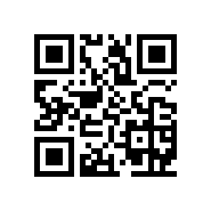
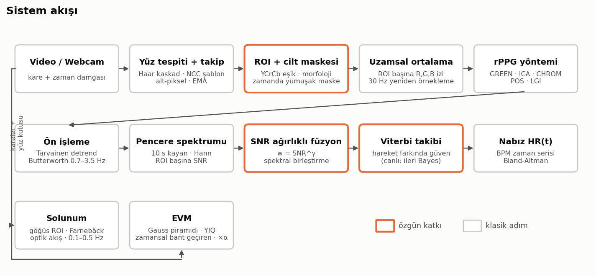

# Kamerayla Temassız Nabız Ölçümü (rPPG)

**Sıradan bir kamera, yüze hiçbir şey takmadan, nabzı 1 BPM civarında hatayla ölçebilir mi?**

Bu proje, yüz derisindeki gözle görülmeyen renk değişimlerinden nabzı ölçen uçtan uca bir sistem. Klasik görüntü ve
sinyal işlemeyle başlayıp derin öğrenmeye uzanıyor; sonunda telefonun tarayıcısında, internetsiz, gerçek zamanlı
çalışıyor.



📱 **Telefonda dene:** **https://nisagwn.github.io/rppg/** (kurulum yok, görüntü telefondan çıkmaz)



---

## Öne çıkanlar

|  | Klasik POS | Hazır derin model (PURE) | **Bu proje** (en iyi tur) |
|---|---:|---:|---:|
| Ana test (28 video, önden webcam) | 3.54 BPM | 2.57 BPM | **1.10 BPM** (5. tur) |
| Telefon / yan USB kamera (28 video) | 15.63 BPM | 7.47 BPM | **1.64 BPM** (5. tur) |
| VIPL-HR (283 video, webcam + telefon) | 4.81 BPM | 4.53 BPM | **3.49 BPM** (7. tur B) |
| DLCN, gece ışığı (152 video) | – | – | **1.31 BPM** (7. tur D) |

Ortalama pencere hatası (10 s pencere, parmak PPG referansı, Viterbi takibiyle). Test kişileri hiçbir eğitimde
kullanılmadı. Her satırın en iyisi farklı bir eğitim turundan; tek bir modelin bütün testlerdeki sonucu ve
anlamlılık testleri için: [`docs/07_arastirma_gunlugu.md`](docs/07_arastirma_gunlugu.md).

- **Hazır ağırlık olmadan da aynı seviye.** 2025 tarihli MMRPhys mimarisi tamamen sıfırdan, yalnızca bizim
  verimizle eğitildi. Ana testte ince ayarlı modelle istatistiksel olarak eşit (1.13 / 1.10 BPM, Wilcoxon p = 0.07).
  Eğitimde hiç görmediği gece verisinde (DLCN) %40 daha iyi genelledi (1.69 / 2.83 BPM, p < 0.001).
- **Açık veri setlerinde sessizce bozuk etiketler bulundu ve düzeltildi.**
  - MCD-rPPG'nin yan kameralarında etiket ~270 ms kayık; bu, yarım nabız periyodu demek, yani etiket fiilen ters.
  - VIPL-HR'de kayma videodan videoya −34 ile +11 kare arasında değişiyor.
  - Eğitilmiş modeli referans alan **video başına hizalama yöntemi** geliştirildi. Hizalamadan sonra bütün
    videolarda tepe tam 0 karede.
- **Telefonda 7 kat daha iyi.** Klasik yöntemin çöktüğü yan açılı ve sıkıştırılmış telefon görüntüsünde
  15.6 → 1.6 BPM.
- **Klasik katkılar derin modelle birleşiyor.** Hareket farkında Viterbi nabız takibi, derin modelin çıktısında da
  hatayı yarıya indiriyor (telefon/USB testinde 3.80 → 1.96 BPM, p < 0.001).

---

## Nasıl çalışıyor

1. **Yüz:** Haar kaskadı ile tespit, takip, 72×72 kırpıntı (telefonda pico).
2. **Nabız dalgası:** iki yol var.
   - **Klasik:** cilt bölgelerinden RGB izleri → POS / CHROM / ICA / LGI → detrend + Butterworth.
   - **Derin öğrenme:** 160 karelik pencereden doğrudan dalga tahmini. Modeller: FactorizePhys (NeurIPS 2024),
     MMRPhys (2025). İkisi de 40–50 bin parametre.
3. **Nabız:** spektrogram → hareket farkında **Viterbi** takibi (projenin klasik aşamadaki katkısı).
4. **Telefon:** model ONNX'e çevrilip tarayıcıda (onnxruntime-web, ayrı iş parçacığında) çalışıyor. Model 163–250 KB.

### Eğitim verisi

| Veri seti | Kişi | Özellik |
|---|---:|---|
| MCD-rPPG | 600 | 3 kamera (önden, telefon, yan USB), dinlenme + egzersiz |
| VIPL-HR | 107 | webcam + Huawei P9 telefon, 9 senaryo (RealSense kaynağı etiket uyumsuz olduğu için çıkarıldı) |
| DLCN | 98 | gece, 10–100 lux değişen ışık |
| COHFACE | 40 | yoğun sıkıştırılmış video |
| UBFC-rPPG, PURE | 42 + 10 | laboratuvar, hareket senaryoları |

Her yeni veri setinde etiket kalitesi (SNR), işaret ve zaman kayması eğitimden önce ölçülüyor; etiketi videoyla
örtüşmeyen videolar eğitime girmiyor.

---

## Mobil uygulama

**https://nisagwn.github.io/rppg/** adresini telefonun tarayıcısında açın. Android ve iPhone'da çalışır;
"Ana ekrana ekle" ile uygulama gibi kullanılır ve sonra internetsiz açılır.

- **Yüz modu (ön ya da arka kamera):** eğitilmiş model (3. tur FactorizePhys) + Viterbi takibi.
- **Parmak modu (arka kamera + flaş):** temaslı PPG; yüz ölçümünü oksimetresiz doğrulamak için.
- Oturum **CSV** olarak indirilebilir. Tüm hesaplama telefonda yapılır.

Sinyal işleme kodu ([`mobile/dsp.js`](mobile/dsp.js)) Python paketinin birebir karşılığı; testler aynı girdide
1e-9 düzeyinde aynı sonucu doğrular. Uygulamanın gerçek veride ölçülmüş son doğrulaması
([`results/mobil_dogrulama/`](results/mobil_dogrulama/SONUCLAR.md)) klasik POS dönemine ait (UBFC 2.0 BPM);
eğitilmiş modelli sürümün aynı doğrulaması henüz yeniden yapılmadı.

---

## Sonuçlar ve belgeler

| Ne | Nerede |
|---|---|
| **Araştırma günlüğü:** bütün deneyler, bulgular, anlamlılık testleri, olumsuz sonuçlar | [`docs/07_arastirma_gunlugu.md`](docs/07_arastirma_gunlugu.md) |
| Eğitim turlarının ayrıntılı sonuçları | [`results/derin_ogrenme/`](results/derin_ogrenme/) (`kaggle_tur*/SONUCLAR.md`) |
| Etiket kalitesi ve zaman kayması analizi | [`results/derin_ogrenme/VERI_KALITESI.md`](results/derin_ogrenme/VERI_KALITESI.md), [`senkron_model.csv`](results/derin_ogrenme/senkron_model.csv) |
| Klasik yöntemler: sentetik, UBFC, MCD, maske deneyi | [`results/synthetic/`](results/synthetic/SONUCLAR.md), [`results/ubfc/`](results/ubfc/SONUCLAR.md), [`results/mcd/`](results/mcd/SONUCLAR.md), [`results/maske_deneyi/`](results/maske_deneyi/SONUCLAR.md) |
| Dönem raporu | [`docs/05_rapor.md`](docs/05_rapor.md) |
| İş planı | [`docs/04_is_plani.md`](docs/04_is_plani.md) |
| Proje önerisi, veri toplama protokolü, sunum taslağı | [`docs/01`](docs/01_proje_onerisi.md), [`02`](docs/02_veri_toplama_protokolu.md), [`06`](docs/06_sunum_taslagi.md) |

---

## Klasik aşamanın katkıları

| # | Katkı | Kod | Sonuç |
|---|---|---|---|
| 1 | Hareket farkında, güvenle ölçeklenen **Viterbi** nabız takibi | `rppg/hr.py`, `fusion.py` | Gerçek veride %12–29, derin modelde ~%50 hata azalması |
| 2 | SNR ağırlıklı çoklu-bölge spektral füzyon | `rppg/fusion.py` | Sentetikte güçlü; gerçek veride genellikle zararlı (dürüstçe raporlandı) |
| 3 | Zamanda yumuşatılmış ağırlıklı cilt maskesi | `rppg/signals.py` | İkili maskenin ışık titremesine kilitlenmesini önler (%100 → ≤0.24 BPM hata) |
| 4 | Kontrollü zorluk senaryolu sentetik benchmark | `rppg/synthetic.py` | 9 zorluk tipi tek tek ayrılarak ölçülür |

Sentetik veride önerilen hat POS ile 0.70 BPM; "hepsi birden" senaryosunda klasik 11.6 → 1.2 BPM. UBFC-rPPG'de klasik
yöntemler 1.5–2.0 BPM.

---

## Hızlı başlangıç

**Windows:** `KURULUM_WINDOWS.bat` (sanal ortam, kütüphaneler, testler), ardından `CALISTIR.bat` menüsü: canlı demo,
video analizi, EVM, kayıt, benchmark, veri seti indirme. **Linux/macOS:** `bash kurulum.sh`.

```bash
python scripts/live_demo.py                          # canlı demo (webcam)
python scripts/run_video.py --video yuz.mp4           # bir videoyu analiz et
python scripts/make_evm_video.py --video yuz.mp4      # nabzı görünür kılan EVM videosu
python -m pytest -q                                   # testler
```

### Derin öğrenme hattı

```bash
python scripts/dl_prepare.py --mcd 60 --ubfc 10      # veri hazırlama (72x72 kırpıntı + etiket)
python scripts/dl_quality.py --data data/dl           # etiket kalitesi (SNR, işaret, kayma)
python scripts/dl_sync_check.py --write --data data/dl --subs vipl   # model tabanlı etiket hizalama
python scripts/dl_train.py --arch mmrphys --epochs 150 --lr 1e-3     # MMRPhys sıfırdan
python scripts/dl_evaluate.py --model results/.../best.pth --name "MMRPhys"
python scripts/dl_compare.py results/.../test_sonuclari.csv "A+Viterbi" "B+Viterbi"   # anlamlılık
python scripts/dl_export_onnx.py --model results/.../best.pth          # telefon için ONNX
```

Büyük eğitimler Kaggle GPU'sunda yapıldı: [`kaggle/rppg_hazirla.ipynb`](kaggle/rppg_hazirla.ipynb) veriyi hazırlayıp
Hugging Face'e koyar; [`kaggle/rppg_egitim_7.ipynb`](kaggle/rppg_egitim_7.ipynb) eğitir, saatte iki kez yedekler ve
oturum kesilirse kaldığı yerden devam eder (Colab'da da çalışır).

---

## Proje yapısı

```
rppg/          klasik çekirdek: yüz/ROI, cilt maskesi, POS/CHROM/ICA/LGI, filtreler, Viterbi, füzyon, EVM, sentetik
scripts/       çalıştırılabilir betikler; dl_*.py derin öğrenme hattı
mobile/        telefon uygulaması (PWA): dsp.js, dl_worker.js (ONNX), model/
kaggle/        Kaggle/Colab defterleri (veri hazırlama, eğitim turları)
results/       deney çıktıları; derin_ogrenme/ altında her eğitim turu
docs/          öneri, plan, rapor, araştırma günlüğü, sunum
tests/         pytest + mobil node testleri
```

---

## Lisanslar ve kaynaklar

- **Modeller:** FactorizePhys ve rPPG-Toolbox (Liu vd. 2023; Joshi ve Cho, NeurIPS 2024), MMRPhys (Joshi ve Cho 2025;
  **yalnızca araştırma amaçlı RAIL lisansı**). Mimariler bu çalışmalardan; ağırlıklar bu projede eğitildi.
- **Veri setleri:** UBFC-rPPG, PURE, MCD-rPPG, VIPL-HR, MMPD, COHFACE, DLCN (CC BY-NC-SA 4.0), UBFC-Phys. Her biri
  kendi lisansı ve kullanım koşuluyla; çoğu yalnızca ticari olmayan araştırmaya izin verir. Veri setleri depoda yok.
- **Temel yöntemler:** Verkruysse vd. 2008; Poh vd. 2010; de Haan ve Jeanne 2013 (CHROM); Wang vd. 2017 (POS);
  Pilz vd. 2018 (LGI); Wu vd. 2012 (EVM). Tam kaynakça: [`docs/05_rapor.md`](docs/05_rapor.md).

### Sorun giderme

| Sorun | Çözüm |
|---|---|
| "Kamera açılamadı" | Kamerayı kullanan başka uygulamayı (Teams, Zoom) kapatın ya da `--camera 1` deneyin. |
| "YÜZ BULUNAMADI" | Yüz önden ve iyi aydınlatılmış olmalı; Haar kaskadı profil yüz bulmaz. |
| Nabız saçma değerlerde | 10 s ısınmayı bekleyin, hareketsiz durun, arkadan gelen ışıktan kaçının. |
| `cv2 ... CascadeClassifier` hatası | OpenCV 5 kurulmuş: `pip install "opencv-python>=4.8,<5"`. |
| `pip install` hatası | Python 3.11 ya da 3.12 önerilir. |
